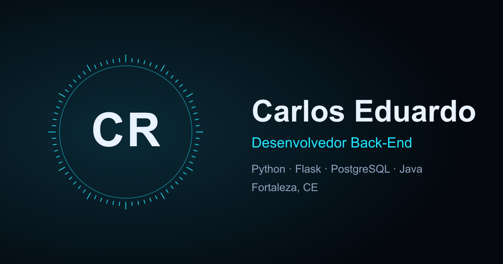

<h1 align="center">👨‍💻 Carlos Eduardo — Desenvolvedor Full Stack</h1>

<p align="center">
  <strong>Meu portfólio: um site com abertura em portal de partículas, case study do GestãoCheck, projetos, minigames e contato.</strong><br>
  Começou no programa <em>Discover</em> da Rocketseat como um site em HTML, CSS e JavaScript puro e foi reconstruído
  em <strong>Vite + React + TypeScript</strong>. Este README conta o que tem no site e o que mudou da v1 para a v2.
</p>

<p align="center">
  <a href="#-live">Live</a>&nbsp;·&nbsp;
  <a href="#-como-este-projeto-evoluiu">Como evoluiu</a>&nbsp;·&nbsp;
  <a href="#-o-que-mudou-da-v1-para-a-v2">O que mudou</a>&nbsp;·&nbsp;
  <a href="#-o-que-tem-no-site">O que tem no site</a>&nbsp;·&nbsp;
  <a href="#%EF%B8%8F-stack">Stack</a>&nbsp;·&nbsp;
  <a href="#-estrutura">Estrutura</a>&nbsp;·&nbsp;
  <a href="#-rodando-localmente">Rodando</a>&nbsp;·&nbsp;
  <a href="#-deploy-na-vercel">Deploy</a>&nbsp;·&nbsp;
  <a href="#-segurança">Segurança</a>
</p>

<p align="center">
  
  
  
  
  
</p>

<p align="center">
  
</p>

## 🔗 Live

**https://carlos-eduardo-portfolio-red.vercel.app** (Vercel, atualiza sozinho a cada push na `main`)

## 🧭 Como este projeto evoluiu

Este repositório nasceu como o projeto do programa **Discover da Rocketseat** e foi crescendo junto comigo: de um
portfólio simples para um case study interativo do GestãoCheck, e agora para uma reconstrução completa com framework.

| Versão | O que era | Onde está |
| --- | --- | --- |
| **v1** (tag [`v1.0.0`](../../releases/tag/v1.0.0)) | Site estático em HTML, CSS e JavaScript puro, sem framework e sem build, publicado no GitHub Pages. | Guardado inteiro em [`versoes-antigas/v1-github-pages`](versoes-antigas/v1-github-pages), com o README e o CLAUDE.md da época |
| **v2** (tag [`v2.0.0`](../../releases/tag/v2.0.0), atual) | Reconstrução em Vite + React + TypeScript, com abertura em portal, seções novas, 6 minigames e deploy na Vercel. | Raiz deste repositório |

A v1 foi mantida como referência e não recebe mais alterações. Para vê-la, abra `versoes-antigas/v1-github-pages/index.html`
com o Live Server (o README antigo, com a descrição completa dela, está na mesma pasta).

## 🔄 O que mudou da v1 para a v2

| | v1 | v2 |
| --- | --- | --- |
| **Tecnologia** | HTML, CSS e JavaScript puro (`index.html`, `style.css`, `script.js`) | Vite, React 19, TypeScript, Tailwind CSS v4 |
| **Animações** | CSS e JavaScript manual | Motion (interface), GSAP (rolagem) e Three.js (partículas) |
| **Abertura** | Fundo de partículas em `<canvas>` | Portal: partículas em WebGL formam o logo **CR**, abrem ao rolar e fecham de volta no fim da página, com loop |
| **Cargo** | Backend Developer | Desenvolvedor **Full Stack** |
| **Hero** | Bio curta com bolha de trajetória | Descrição profissional, bloco estilo terminal (`whoami`, stack, status) e foto de perfil diferente por tema |
| **Trajetória** | Texto dentro da bolha da foto | Seção própria com 4 etapas (Alares, Lanlink, GestãoCheck, Engrenagem Tech) e ilustração do setup |
| **Skills** | Ícones com tooltip de nível | 3 grupos (uso no dia a dia, já usei em projeto, estudando) com a explicação de onde cada tecnologia é usada |
| **GestãoCheck** | Case study com galeria em modal | Visualizador de telas reais (claro e escuro), descrições de cada tela, tour automático e contadores 16+ módulos e 189+ testes |
| **Empresa** | Não tinha | Seção **Engrenagem Tech**, com prints do site, 6 demos e links |
| **Outros projetos** | Cards com preview em modal | Cards com inclinação 3D, diagrama animado e janela de detalhes com o que tem dentro de cada projeto e link do GitHub |
| **Conquistas** | Carrossel horizontal | Seção **Formação e certificados**: ADS, pós em Computação Forense e cursos, com os PDFs abrindo dentro do site e botão "Ver mais" |
| **Minigames** | Snake, Jogo da Velha, Pong e Java vs IA | Seis jogos: a cobrinha agora tem rosto, estrela bônus e acelera; o Jogo da Velha ganhou CPU difícil; o Pong ganhou 3 níveis; e entraram **Memória Dev** e **2048** |
| **Contato** | Links no rodapé | Seção própria com WhatsApp (já com mensagem pronta), e-mail, LinkedIn e GitHub, e rodapé com a data da última atualização |
| **Segurança** | CSP via `<meta>` e SRI nos CDNs | CSP, HSTS e cache por headers da Vercel, sem scripts inline e sem CDN externo (fontes e imagens locais) |
| **Hospedagem** | GitHub Pages | Vercel, com deploy automático |

### O que eu fiz para chegar na v2

- **Guardei a v1 inteira** em `versoes-antigas/v1-github-pages` e levei o site novo para a raiz do mesmo repositório.
- **Renomeei o projeto** de `Projeto-RocketSeat` para `carlos-eduardo-portfolio` (repositório, pacote e documentação).
- **Troquei o logo** de CE para **CR**, porque "CE" lembrava Ceará.
- **Atualizei o perfil** para Full Stack, reescrevi a descrição e incluí as fotos de perfil: camisa azul-marinho no tema escuro e camisa branca no tema claro.
- **Criei as seções novas** (trajetória com tecnologias, Engrenagem Tech, formação e certificados, minigames, contato) e refiz o GestãoCheck e os projetos.
- **Reescrevi os jogos** do zero e acrescentei dois novos.
- **Usei minhas ilustrações** no site: o setup ilustrado em Sobre e o retrato 3D em Contato.
- **Deixei pronto para a Vercel** (`vercel.json`, headers de segurança, meta tags de compartilhamento, sitemap e robots automáticos) e publiquei com as tags e os releases `v1.0.0` e `v2.0.0`.

## 🧩 O que tem no site

1. **Hero:** abertura em portal de partículas, apresentação, bloco estilo terminal e atalhos (WhatsApp, LinkedIn, GitHub e currículo). Existe o botão "Pular intro" e o tema escuro e claro troca a foto de perfil.
2. **Minha trajetória:** linha do tempo com as 4 etapas e os 3 grupos de tecnologias, com explicação ao passar o mouse.
3. **GestãoCheck:** case study do ERP em que sou desenvolvedor back-end, com telas reais, tour automático e contadores.
4. **Minha empresa:** Engrenagem Tech, o que faz, prints do site e 6 demos no ar.
5. **Outros projetos:** API REST com Spring Boot, Agente de IA para Service Desk, Chess System e FitTribe, cada um com janela de detalhes.
6. **Formação e certificados:** graduação em ADS (Senac-CE), pós-graduação em Computação Forense (Unopar) e cursos, com os PDFs dentro do site.
7. **Pausa pro café:** Snake, Jogo da Velha, Pong, Java vs IA, Memória Dev e 2048, com recordes salvos no navegador.
8. **Contato:** WhatsApp, e-mail, LinkedIn e GitHub.

Também tem: tema escuro e claro com transição, layout mobile first, suporte a `prefers-reduced-motion` e uma versão sem
animação para dispositivos sem WebGL, economia de dados ou pouca memória.

## 🛠️ Stack

| Camada | Ferramentas |
| --- | --- |
| Interface | React 19, TypeScript, Tailwind CSS v4 |
| Animação | Motion (interface), GSAP com ScrollTrigger e Observer (rolagem) |
| 3D | Three.js (partículas em WebGL com shader próprio) |
| Build | Vite |
| Fontes | Space Grotesk, Inter e JetBrains Mono, hospedadas no próprio site |
| Hospedagem | Vercel |
| Ferramentas de imagem | `sharp` (conversão para WebP e imagem de compartilhamento) |

## 📁 Estrutura

```
carlos-eduardo-portfolio/
├── index.html              # casca estática, meta tags e scripts de entrada
├── vite.config.ts          # build, data do rodapé e meta tags de URL
├── vercel.json             # headers de segurança e cache
├── src/
│   ├── components/         # uma seção por arquivo (Intro, About, GestaoCheck, Engrenagem, Projects, Education, Games, Contact...)
│   │   └── games/          # Snake, Jogo da Velha, Pong, Java vs IA, Memória Dev e 2048
│   ├── hooks/              # rolagem do portal (GSAP)
│   ├── lib/                # partículas (Three.js), logo, tema
│   └── data/               # tamanhos das imagens gerados pelos scripts
├── public/                 # fotos, ilustrações, telas, certificados (PDF) e currículo
├── scripts/                # conversão de imagens para WebP e imagem de compartilhamento
├── versoes-antigas/
│   └── v1-github-pages/    # a v1 inteira (HTML, CSS, JS, assets, README e CLAUDE.md)
└── CLAUDE.md               # contexto e regras do projeto
```

## 🚀 Rodando localmente

```bash
git clone https://github.com/carloseduardo-rocha/carlos-eduardo-portfolio.git
cd carlos-eduardo-portfolio
npm install
npm run dev      # desenvolvimento
npm run build    # tsc + build de produção em dist/
npm run preview  # serve o build com os mesmos headers de segurança da Vercel
```

## ☁️ Deploy na Vercel

1. Na Vercel: **Add New → Project** e escolha este repositório. O preset Vite é detectado sozinho
   (build `npm run build`, saída `dist`).
2. A URL pública entra sozinha em `og:url`, `og:image`, `canonical`, `sitemap.xml` e `robots.txt`
   (via `VERCEL_PROJECT_PRODUCTION_URL`). Com domínio próprio, crie a variável `SITE_URL`
   (ex.: `https://meudominio.com`) e faça um novo deploy.
3. Headers de segurança e cache ficam em `vercel.json`. A data do rodapé ("Última atualização") é a data do build.

## 🔒 Segurança

- **CSP** restritiva e **HSTS** por headers (`vercel.json`), sem scripts inline: o script do tema e o de entrada são arquivos.
- Fontes, imagens e certificados são servidos pelo próprio site, sem CDN externo.
- `rel="noopener noreferrer"` em todo `target="_blank"`.
- `npm run preview` aplica os mesmos headers, então qualquer quebra de CSP aparece antes do deploy.
- `.gitignore` protege `.claude/settings.local.json`.

## 📄 Sobre

Projeto pessoal de **Carlos Eduardo Rocha**, desenvolvedor Full Stack em Fortaleza, desenvolvedor back-end do
[GestãoCheck](https://gestaocheck.tech) e fundador da Engrenagem Tech. Sinta-se à vontade para se inspirar no código.

<p align="center">
  <a href="https://www.linkedin.com/in/carlos-eduardo-rocha-da-silva-408087230/">LinkedIn</a> ·
  <a href="https://github.com/carloseduardo-rocha">GitHub</a> ·
  <a href="https://www.instagram.com/cadurochhaa/">Instagram</a>
</p>
